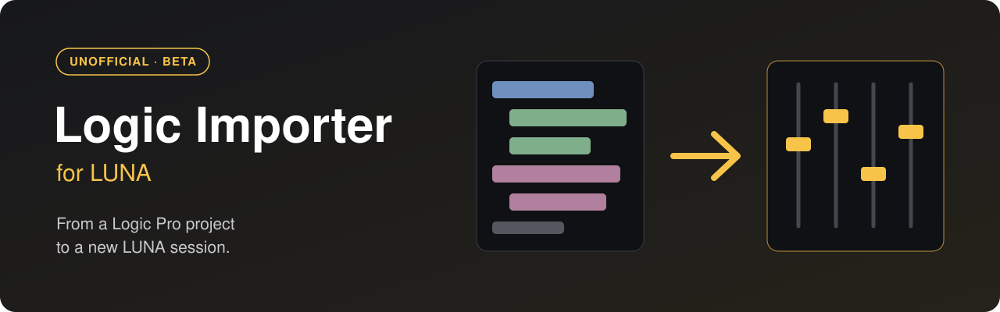

# Logic Importer for LUNA (beta)

A LUNA Add On that creates a **new session** from a Logic Pro project and gives you a report of
what to check or fix by hand.

> [!IMPORTANT]
> This is an **unofficial beta** project. It is not affiliated with Apple or Universal Audio.
> **It does not make an exact copy.** Keep your Logic project, and compare the two mixes by ear.

## Contents

- [What it tries to transfer](#what-it-tries-to-transfer)
- [Requirements](#requirements)
- [Installation](#installation)
- [How to use it](#how-to-use-it)
- [The report](#the-report)
- [The helper](#the-helper)
- [Privacy and safety](#privacy-and-safety)
- [Known limitations](#known-limitations)
- [Testing status](#testing-status)
- [Troubleshooting](#troubleshooting)
- [Development](#development)
- [License and credits](#license-and-credits)

## What it tries to transfer

| In Logic Pro | In LUNA |
|---|---|
| Tracks, names and order | Tracks and buses |
| **Summing Stacks** | **Summing folders**, including nested ones |
| Folder Stacks | Grouping folders (without their mixer settings) |
| Outputs, sends, volume, pan, mute and solo | Routing and mixer |
| Audio regions, mutes and fades | Clips. Fade shapes are approximate |
| Region gain | Clip gain line (whole-dB values on confirmed Logic versions) |
| MIDI notes, controllers and pitch bend | MIDI clips |
| Tempo, time signatures and markers | Tempo, time signatures and markers |
| Volume, pan, mute and plug-in automation | Automation points, where there is an equivalent control |
| Third-party AU plug-ins | The matching installed plug-in, with the settings LUNA accepts |

Appearing in this table does not mean a feature has been tested in a real copy of LUNA. Check
the [testing status](#testing-status).

### How plug-in settings are handled

A setting counts as kept only when the importer **reads that value back from LUNA**.
Parameters that differ from the plug-in's default and are not kept are labelled **MODIFIED** in
the report, along with the value they had in Logic.

Internal state that a plug-in does not expose as parameters is not copied or compared.

## Requirements

- A Mac with **Apple silicon**.
- **LUNA 3.1.2** or later.
- A saved Logic Pro project (`.logicx`). The live test used **Logic 13.0**. The project reader,
  logicxkit, reports its main testing on 12.3.1 and 12.4.
- The project's third-party plug-ins, installed and authorized on the Mac.
- An administrator password to install the helper.

To use the Add On you **do not need** to install Python, Node.js or developer tools.

## Installation

1. From the [Releases](../../releases) page, download `Logic-Importer.lunaaddon`.
   "Source code" downloads do not include the installer.
2. Open the file to install it in LUNA.
3. Open **Logic Importer** from **Add Ons → Windows**.
4. Follow step 1 in the window to install the helper.

**macOS warning:** unless a release says it is signed and notarized, macOS may block the
installer. If you downloaded it from this repository and trust it, go to
**System Settings → Privacy & Security → Open Anyway**.

To check your download, save the `.sha256` file in the same folder and run:

```sh
shasum -a 256 -c Logic-Importer.lunaaddon.sha256
```

## How to use it

You do not need to create an empty session first.

### 1. Install the helper (once)

1. Click **Get the helper installer**. If Finder does not open, the window shows the location.
2. Open **Logic Importer Helper.pkg** and complete the installation.
3. At **Did you install the helper?**, click **Yes**. The next step unlocks only if the Add On
   can reach the helper. **No** shows the instructions.

### 2. Export Logic Metadata

1. Save your project in Logic. Use a copy for your first tests.
2. Click **Choose project…** or **Choose project folder…**.
3. Click **Export Logic Metadata**.

This creates a folder named `Project name for LUNA` beside the project. It holds the import file
and copies of the audio used. You need free space for those copies and for the new session.

### 3. Choose the output folder and import

1. **Save your current LUNA session**, because LUNA will switch to another one.
2. Click **Choose output folder…** and enter a session name.
3. Click **Begin session import** and keep the window open until it finishes.

### 4. Check the report

Work through the open items, compare the two mixes by ear, and **save the session in LUNA**.

> [!TIP]
> You can delete the `… for LUNA` folder once the import has finished, the session is saved and
> you have checked that its audio plays. Do not delete your original project.

## The report

- **Simplified:** starts with **To do or check by hand**: side-chains, missing plug-ins, values
  to set and items that were not transferred. A summary follows.
- **Extended version:** details the channels, plug-ins, **MODIFIED** parameters and every
  logged problem.

**Copy this version** copies the version on screen. **Save both as file** asks to save both.
These buttons still need testing inside LUNA.

## The helper

An Add On is a web page and cannot run the project reader by itself. The helper is a small local
app that opens the macOS file pickers and runs the conversion.

```text
Logic project ──► Helper (on your Mac) ──► Add On ──► New LUNA session
```

It is designed to start automatically when you log in to your Mac.

| Item | Location |
|---|---|
| App and uninstaller | `/Library/Application Support/Logic Importer` |
| Automatic startup | `/Library/LaunchAgents/com.logicimporter.helper.plist` |
| Your private key | `~/Library/Application Support/Logic Importer` |

### Uninstalling

Removing the Add On from LUNA **does not uninstall the helper**. To remove it:

1. In Finder, choose **Go → Go to Folder…**.
2. Enter `/Library/Application Support/Logic Importer`.
3. Open **Uninstall Logic Importer Helper**.
4. Type `yes`, then enter your administrator password when macOS asks.

The uninstaller has not been tested yet.

## Privacy and safety

- Your Logic project is opened **for reading only**.
- Importing always creates a new LUNA session.
- The project's code does not upload your files to any server.
- The helper listens only on `127.0.0.1`, requires a private key, and reads only projects you
  choose in a macOS picker.
- To read plug-in settings, the helper **loads the third-party Audio Units** in your project, as
  a plug-in host does. Those plug-ins run their own code.
- Exports and reports contain track and plug-in names, and exports also contain audio. Check
  them before sharing.

## Known limitations

- LUNA cannot load Logic's own plug-ins or instruments. To keep their sound, you can export
  those tracks as audio from Logic.
- A third-party plug-in loads only if the importer finds its match in LUNA.
- Some parameters use another scale, or LUNA rejects the value. The report lists them to set by
  hand.
- Side-chains must be assigned by hand.
- Stereo balance, fade shapes and automation curves may differ.
- Not transferred: region transpose and reverse, region loops (only the first pass is placed),
  region or relative automation, and track colors.
- Not checked: Flex, Take Folders, groups, VCAs, Smart Controls and surround.
- Only the first project alternative is read.
- Region gain with an unconfirmed unit is reported but not applied.
- Controller and pitch bend data are written but not read back to check them.

## Testing status

| Scope | What was checked |
|---|---|
| Real LUNA 3.1.2, one Logic 13.0 project, with an earlier version | Tracks, 7 summing folders, routing, faders, mutes, clip positions and tempo; 51 of 55 plug-ins loaded; 314 of 320 changed settings kept |
| Audio exported from LUNA | Whole-dB region gain |
| Only the SDK's mock LUNA | MIDI, automation, sends, and the new read-back checks for solo, mute, sends and bypass |
| Browser with mock LUNA | The interface steps and the lock on the install step |
| Version 0.2.0 automated tests | 43 Add On tests and 10 helper tests passed |

**Still to verify:** the complete 0.2.0 workflow inside LUNA, the macOS pickers, saving to the
chosen folder, automatic startup after a restart, uninstalling, installing from the GitHub
address, installer signing, and a second Mac. See the full checklist in
[docs/TESTING.md](docs/TESTING.md).

## Troubleshooting

| Problem | What to try |
|---|---|
| Clicking **Yes** does not unlock step 2 | Check that the installer finished, close and reopen the window, and click **Yes** again. If nothing changes, restart your Mac |
| macOS blocks the installer | See the warning under [Installation](#installation) |
| The file picker does not appear | Check whether it opened behind LUNA |
| macOS asks for access to a folder | The helper needs it to read your chosen project and create the export |
| A plug-in is missing | Check that it is installed, authorized and visible in LUNA. Logic's own plug-ins cannot be loaded |
| The import stops | The new session is incomplete. Read the message and do not use that session as your final copy |

When reporting a problem, include your macOS, LUNA and Logic versions, the step and the message.
**Do not post** projects, audio, reports with private names, or `helper-config.js`.

## Development

You need Apple silicon, the Xcode command line tools, Node.js 22+, Python 3.12+ and Git.

```sh
./setup.sh      # once: downloads pinned versions of the dependencies
./release.sh    # installer, tests, package and privacy check
```

`setup.sh` downloads the LUNA Builder SDK. Universal Audio states that downloading or using it
means accepting Apache 2.0 and its
[supplemental terms](https://github.com/uaudio-labs/luna-builder-sdk/blob/main/SUPPLEMENTAL-TERMS.md).
The script asks you to accept before it continues.

The output goes to `dist/`.

| Folder | Contents |
|---|---|
| `add-on/` | The JavaScript Add On and its tests |
| `converter/` | Logic reader, Audio Unit settings reader and helper |
| `installer/` | macOS installer and uninstaller files |
| `docs/` | Publishing, signing, testing and release notes |

Guides: [publishing](docs/PUBLISHING.md) · [signing and notarization](docs/SIGNING.md) ·
[testing](docs/TESTING.md) · [release notes](docs/RELEASE_NOTES.md)

## License and credits

This project's own code is licensed under [Apache 2.0](LICENSE); see also [NOTICE](NOTICE).
Third-party components keep their own terms, listed in
[THIRD_PARTY_NOTICES.md](THIRD_PARTY_NOTICES.md). They include:

- [LUNA Builder SDK](https://github.com/uaudio-labs/luna-builder-sdk) by Universal Audio:
  Apache 2.0 **plus its supplemental terms**.
- [logicxkit](https://github.com/phierceweb/logicxkit) by Mike Farr: Apache 2.0.

"Logic Pro", "Audio Units", "macOS" and "Apple" are trademarks of Apple Inc. "LUNA", "UAD",
"UADx" and "Universal Audio" are trademarks of Universal Audio, Inc. Other names belong to their
owners.
